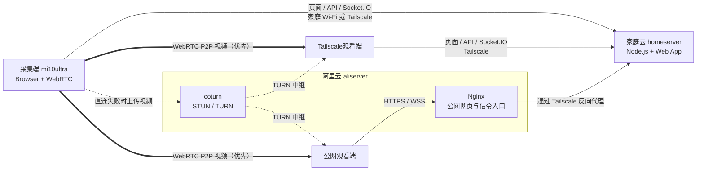

# Home Surveillance

将闲置安卓手机改造成一个云边混合 WebRTC 家庭监控平台。

本项目采用 **家庭云为核心、阿里云为公网网关、Tailscale 为私有网络通道、WebRTC Mesh 传输视频流** 的架构。目标是在家中低延迟观看，在外网稳定访问，同时尽量降低公网暴露面和云服务器流量成本。

## 目录

- [架构结论](#架构结论)
  - [采用方案](#采用方案)
  - [核心角色](#核心角色)
  - [访问链路](#访问链路)
  - [信令路径](#信令路径)
- [必须注意](#必须注意)
- [开发配置](#开发配置)
- [部署配置](#部署配置)
  - [准备生产 `.env`](#1-准备生产-env)
  - [构建并用 PM2 启动](#2-构建并用-pm2-启动)
  - [配置 Tailscale HTTPS](#3-配置-tailscale-https)
  - [配置阿里云 Nginx](#4-配置阿里云-nginx)
  - [配置 coturn 和安全组](#5-配置-coturn-和安全组)
  - [阿里云容量估算](#6-阿里云容量估算)
  - [部署验收](#7-部署验收)
  - [环境变量参考](#环境变量参考)
- [前端路由](#前端路由)
- [WebRTC 画质诊断](#webrtc-画质诊断)
- [人脸流程与数据落盘](#人脸流程与数据落盘摘要)

## 架构结论

### 采用方案

这套架构比单纯“阿里云部署全部服务”更适合家庭监控：视频优先走端到端 P2P 或私有网络，阿里云只负责公网入口和必要时的 TURN 中继：

- **家庭云承载主服务**：运行 Node.js 信令服务，托管前端页面，作为边缘计算中心。
- **旧手机作为采集端**：连接家庭 Wi-Fi，并已接入 Tailscale，访问家庭云页面并授权摄像头。
- **Tailscale 私有访问链路**：私人设备在外网时通过 Tailscale 访问家庭云，避免直接暴露家庭网络。
- **阿里云为公网网关和 TURN**：Nginx 通过 Tailscale 反向代理到家庭云，coturn 提供 STUN/TURN 能力。

### 核心角色



图中的实线细箭头是网页与信令路径，粗箭头是优先使用的 P2P 视频路径，虚线是直连失败后的 TURN 兜底路径。采集端如果使用阿里云公网域名，其页面与信令也会先经过 Nginx；媒体仍独立选择 P2P 或 TURN，不会因为使用公网域名就必然经过 coturn。其中各个 Tailscale 节点如下：

| 节点           | 角色                     | Tailscale IP     |
| ------------ | ---------------------- | ---------------- |
| `homeserver` | 家庭云，主服务节点              | `100.65.192.69`  |
| `aliserver`  | 阿里云公网网关，Nginx + coturn | `100.115.222.54` |
| `mi10ultra`  | 旧手机采集端                 | `100.126.250.4`  |

### 访问链路

- 内网通道

适用于你自己的设备。

观看端直接访问家庭云的路由器 Wi-Fi 地址或者 Tailscale 地址。信令服务和前端资源都从家庭云获取；由于旧手机 `mi10ultra` 也已接入 Tailscale，WebRTC 可以同时尝试家庭 Wi-Fi 和 Tailscale 私有地址候选。这个链路延迟低、成本低、隐私性最好。

- 公网阿里云通道

适用于不方便安装 Tailscale 的设备或临时分享场景。

观看端访问公网域名，例如 `https://www.kaitool.top/surveillance`。阿里云 `aliserver` 的 Nginx 接收 HTTPS 和 WebSocket 请求，再通过 Tailscale 将请求反向代理到家庭云 `100.65.192.69`。WebRTC 媒体连接优先 P2P，失败时通过阿里云 coturn 走 TURN 中继。

### 信令路径

访问地址只决定网页、API 和 Socket.IO 信令是否经过 Nginx，不会直接决定视频是否经过 coturn。Nginx 与 coturn 是两条相互独立的路径：

```text
网页、API、信令：
  内网 ─────────────────────→ homeserver
  公网 ─→ aliserver Nginx ─Tailscale→ homeserver

WebRTC 视频：
  优先：采集端 ─────────── P2P ───────────→ 观看端
  兜底：采集端 ─→ aliserver coturn ───────→ 观看端
```

| 页面访问方式 | 网页、API、Socket.IO 信令 | WebRTC 视频 |
| --- | --- | --- |
| 内网 | 直接访问 `homeserver`，不经过 Nginx | 仍然优先 P2P，直连失败才使用 coturn |
| 公网 | 经过 Nginx，再通过 Tailscale 转发到 `homeserver` | 仍然优先 P2P，直连失败才使用 coturn |

完整连接过程如下：

1. 采集端和观看端加载页面，并连接同一个 Socket.IO 信令服务。
2. 双方通过信令服务交换 SDP 和 ICE candidate。
3. WebRTC 优先尝试局域网、Tailscale、公网映射等可直接到达的路径。
4. 所有直连路径都失败时，才使用 coturn 的 `relay` candidate 中继视频。

因此，即使页面使用阿里云域名，视频也可能完全不经过阿里云；反过来，即使页面使用 Tailscale 域名，只要 ICE 配置包含 TURN 且直连失败，视频仍可能回退到 coturn。实际路径以采集端或观看端诊断面板中的 ICE 类型为准：`relay` 表示视频经过 coturn，`host` 或 `srflx` 表示未使用 TURN 中继。采集端需要 HTTPS 安全上下文才能稳定获取摄像头权限。建议使用 Tailscale Serve 提供的 HTTPS 域名，不要使用 `http://100.x.x.x/...` 形式的裸 Tailscale IP 地址。

## 必须注意

- `getUserMedia` 需要 HTTPS 或 `localhost`。旧手机访问家庭云页面时也要解决 HTTPS 问题。
- Nginx 可以代理网页和 WebSocket，但不能代理 WebRTC 的 UDP 媒体流。
- coturn 必须独立部署并开放 UDP `3478` 和中继端口范围。
- STUN 只能辅助打洞，不能保证一定成功；TURN 才是公网稳定观看的兜底。
- Mesh 架构下，观看端越多，旧手机上行压力越大。第一阶段建议限制 1 到 2 个观看端。

## 开发配置

项目使用仓库根目录的 `.env` 作为单一配置来源，该文件已被 Git 忽略。服务端启动时读取它，`npm run dev` 会把它传给 server 和 Vite，`npm run build:prod` 会在构建时把对应值注入前端。配置模板见 [.env.example](.env.example)。

建议使用 Node.js 20 LTS 或更新的 LTS 版本。首次启动：

```bash
cp .env.example .env
npm install
npm run dev
```

本地开发可使用以下配置：

```env
NODE_ENV=development
PORT=3333
PUBLIC_BASE_PATH=
ROOM_TOKEN=replace-with-random-token
MAX_VIEWERS_PER_ROOM=2
ALLOWED_ORIGINS=http://localhost:5173,http://localhost:3333
ICE_SERVERS_JSON=[{"urls":"stun:stun.l.google.com:19302"},{"urls":"stun:global.stun.twilio.com:3478"}]

ADMIN_TOKEN=replace-with-another-random-token

VITE_PUBLIC_BASE_PATH=
VITE_ROOM_TOKEN=replace-with-random-token
VITE_ICE_SERVERS_JSON=[{"urls":"stun:stun.l.google.com:19302"},{"urls":"stun:global.stun.twilio.com:3478"}]
VITE_PUBLIC_ORIGIN=http://localhost:5173
VITE_INTERNAL_ORIGIN=http://localhost:5173
```

启动后可访问：

```text
采集端：http://localhost:5173/camera/home
观看端：http://localhost:5173/viewer/home
后台：  http://localhost:5173/admin
健康检查：http://localhost:3333/healthz
```

开发环境如设置 `VITE_PUBLIC_BASE_PATH=/surveillance`，前三个地址也要加 `/surveillance` 前缀。`ADMIN_TOKEN` 为空时，后台管理接口会返回 `503 admin_not_configured`。

## 部署配置

推荐把 Node.js 信令服务和前端部署在 `homeserver`，由阿里云 Nginx 通过 Tailscale 反向代理；coturn 也部署在具有公网 IPv4 的阿里云服务器。完整的节点规划和分阶段部署说明见 [docs/5.部署方案.md](docs/5.部署方案.md)。

### 1. 准备生产 `.env`

在 `homeserver` 的仓库根目录创建 `.env`。以下示例使用 `/surveillance` 子路径，域名、口令和 TURN 密码必须替换：

```env
NODE_ENV=production
PORT=3333
PUBLIC_BASE_PATH=/surveillance
ROOM_TOKEN=replace-with-a-long-random-token
MAX_VIEWERS_PER_ROOM=2
ALLOWED_ORIGINS=https://homeserver.example.ts.net,https://www.example.com
ICE_SERVERS_JSON=[{"urls":"stun:stun.l.google.com:19302"},{"urls":["turn:www.example.com:3478?transport=udp","turn:www.example.com:3478?transport=tcp"],"username":"turn-user","credential":"replace-with-turn-password"}]

WEWORK_RELAY_URL=
WEWORK_RELAY_API_KEY=
WEWORK_RELAY_TOUSER=
FACE_ALERT_ORIGIN_PRIMARY=https://homeserver.example.ts.net
FACE_ALERT_ORIGIN_SECONDARY=https://www.example.com
FACE_ALERT_COOLDOWN_MS=120000

ADMIN_TOKEN=replace-with-a-different-long-random-token

VITE_PUBLIC_BASE_PATH=/surveillance
VITE_ROOM_TOKEN=replace-with-a-long-random-token
VITE_ICE_SERVERS_JSON=[{"urls":"stun:stun.l.google.com:19302"},{"urls":["turn:www.example.com:3478?transport=udp","turn:www.example.com:3478?transport=tcp"],"username":"turn-user","credential":"replace-with-turn-password"}]
VITE_PUBLIC_ORIGIN=https://www.example.com
VITE_INTERNAL_ORIGIN=https://homeserver.example.ts.net
```

关键对齐规则：

- `PUBLIC_BASE_PATH` 与 `VITE_PUBLIC_BASE_PATH` 必须一致。
- `ROOM_TOKEN` 与 `VITE_ROOM_TOKEN` 必须一致。
- `ICE_SERVERS_JSON` 与 `VITE_ICE_SERVERS_JSON` 应保持一致。
- `VITE_PUBLIC_ORIGIN` 填阿里云公网 HTTPS Origin，`VITE_INTERNAL_ORIGIN` 填家庭云 Tailscale HTTPS Origin；后台用它们生成四种房间入口地址。
- 两个入口变量未设置时，`npm run dev` 和 `npm run build:prod` 会分别回退到 `FACE_ALERT_ORIGIN_SECONDARY`（公网）与 `FACE_ALERT_ORIGIN_PRIMARY`（内网）。
- `ALLOWED_ORIGINS` 只填写浏览器 Origin，即“协议 + 域名 + 可选端口”，不要带 `/surveillance` 路径。
- `VITE_*` 会写入前端构建产物，修改后必须重新执行 `npm run build:prod`。固定的 TURN 凭据和 `VITE_ROOM_TOKEN` 对私有 MVP 可用，但公网长期运行应升级为服务端签发的短期凭据和 token。

`npm run build:prod` 在未显式配置 `VITE_*` 时会尝试从对应的非 `VITE_` 变量推导；生产环境仍建议像上例一样显式设置，避免前后端路径或口令不一致。可用 `openssl rand -hex 32` 分别生成 `ROOM_TOKEN` 和 `ADMIN_TOKEN`。

### 2. 构建并用 PM2 启动

```bash
npm install
npm run typecheck
npm run build:prod
npx pm2 start ecosystem.config.cjs
npx pm2 save
```

[ecosystem.config.cjs](ecosystem.config.cjs) 只定义进程入口和工作目录，不保存密钥。生产进程运行 `server/dist/index.js`，并由服务端托管 `web/dist`。更新代码后重新构建，再执行：

```bash
npx pm2 restart home-surveillance
npx pm2 logs home-surveillance
```

如需开机启动，执行 `npx pm2 startup`，按其输出完成系统配置后再次执行 `npx pm2 save`。

### 3. 配置 Tailscale HTTPS

浏览器摄像头权限要求 HTTPS 或 `localhost`，因此旧手机不能长期使用家庭云裸 IP 的 HTTP 地址。可在 `homeserver` 上把 Tailscale HTTPS 域名转发到 Node.js：

```bash
tailscale serve --https=443 / http://127.0.0.1:3333
```

不同 Tailscale 版本的命令语法可能不同，以 `tailscale serve --help` 为准。完成后应能访问：

```text
https://homeserver.example.ts.net/surveillance/camera/home
https://homeserver.example.ts.net/surveillance/viewer/home
```

### 4. 配置阿里云 Nginx

下面示例将公网 `/surveillance/` 下的页面、API 和 Socket.IO 一并通过 Tailscale 转发到 `homeserver`。将域名、证书路径和家庭云 Tailscale IP 替换为实际值：

```nginx
server {
    listen 80;
    server_name www.example.com;
    return 301 https://$host$request_uri;
}

server {
    listen 443 ssl http2;
    server_name www.example.com;

    ssl_certificate /etc/letsencrypt/live/www.example.com/fullchain.pem;
    ssl_certificate_key /etc/letsencrypt/live/www.example.com/privkey.pem;

    location /surveillance/ {
        client_max_body_size 15m;
        proxy_pass http://100.65.192.69:3333/surveillance/;
        proxy_http_version 1.1;
        proxy_set_header Upgrade $http_upgrade;
        proxy_set_header Connection "upgrade";
        proxy_set_header Host $host;
        proxy_set_header X-Real-IP $remote_addr;
        proxy_set_header X-Forwarded-For $proxy_add_x_forwarded_for;
        proxy_set_header X-Forwarded-Proto $scheme;
        proxy_read_timeout 3600s;
        proxy_send_timeout 3600s;
    }
}
```

Nginx 只代理网页和 WebSocket，不代理 WebRTC UDP 媒体流。公网复杂网络下的视频兜底由 coturn 提供。

### 5. 配置 coturn 和安全组

阿里云安全组至少放行：

```text
TCP 80
TCP 443
UDP 3478
TCP 3478
UDP 49160-49200
```

`turnserver.conf` 关键配置示例：

```conf
listening-port=3478
fingerprint
lt-cred-mech
realm=www.example.com
external-ip=<阿里云公网IPv4>
user=turn-user:replace-with-turn-password
min-port=49160
max-port=49200
no-cli
```

`external-ip` 必须是阿里云公网 IPv4，relay 端口范围必须与安全组一致。可用 [Trickle ICE](https://webrtc.github.io/samples/src/content/peerconnection/trickle-ice/) 验证：出现 `srflx` 表示 STUN 正常，出现 `relay` 表示 TURN 正常。

### 6. 阿里云容量估算

当前阿里云实例为 **2 核 CPU、2 GiB 内存、40 GiB 系统盘、200 Mbps 峰值公网带宽**。以下按“一组 = 1 个采集端 + 1 个观看端”、各组使用独立房间估算。

媒体是否经过阿里云决定了容量模型：

- **P2P / Tailscale 直连**：阿里云只承载 HTTPS、API 和 Socket.IO 信令，视频不占用其公网带宽。2 核 2 GiB 通常足以承载几十到上百组信令连接，但这不是保证值，实际瓶颈会转移到家庭云、采集端上行、浏览器和网络质量，正式扩容前仍需压测。
- **TURN 中继**：每路视频先进入 coturn，再从阿里云发给观看端，200 Mbps 公网带宽成为主要瓶颈。coturn 只转发数据、不解码或转码，预计会先碰到带宽限制，而不是 CPU 限制。

按 200 Mbps 为独立公网出口上限，并预留约 30% 给协议开销和网络波动时，可参考：

| 单路实际视频码率 | 理论上限 | 建议稳定运行 |
| --- | ---: | ---: |
| 约 2.5 Mbps（常见 720p） | 约 70 组 | 40～50 组 |
| 约 4 Mbps（常规 1080p） | 约 45 组 | 25～30 组 |
| 6 Mbps（高质量 1080p） | 约 30 组 | 18～22 组 |

当前代码将每个观看端的视频发送上限设置为 **6 Mbps**，见 [web/src/shared/rtc.ts](web/src/shared/rtc.ts)。因此，在无法预先保证 P2P 成功、需要按所有连接都经 TURN 设计时，建议把这台实例的容量按 **20 组 1080p** 规划，30 组只作为理论值，不作为生产承诺。

估算还需考虑以下条件：

- 表中的“单路码率”应以采集端和观看端诊断面板显示的实际发送/接收码率为准，而不是只看分辨率。
- 如果阿里云套餐的 200 Mbps 限制按公网入站与出站流量合计，而非各方向独立限制，TURN 路数需在表中结果基础上大致减半。
- “峰值带宽”不等于持续保证带宽，跨运营商路由、UDP 丢包和高峰期抖动都会减少可用路数。
- 一路 6 Mbps TURN 视频约产生 2.7 GB/小时、1.94 TB/月的公网出站流量；20 路全天运行约 39 TB/月。需先核对实例流量包和超额费用，实际成本通常会比 CPU 更早成为限制。
- 当前项目不录制视频，40 GiB 系统盘可以承载应用和少量陌生人截图，但不适合保存监控录像。
- `MAX_VIEWERS_PER_ROOM` 限制的是单个房间的观看端数量，不是全局房间数量；当前服务没有全局房间数硬限制。

容量规划应优先提高 P2P 成功率，让 TURN 只兜底少数连接。上线后持续观察 TURN 出站带宽、实际中继比例、CPU、内存和丢包率，再决定是否扩容或拆分独立 TURN 节点。

### 7. 部署验收

按顺序检查，便于区分应用、代理和媒体链路问题：

```text
http://127.0.0.1:3333/healthz
http://127.0.0.1:3333/surveillance/healthz
http://127.0.0.1:3333/surveillance/api/ice-servers
https://www.example.com/surveillance/camera/home
https://www.example.com/surveillance/viewer/home
https://www.example.com/surveillance/socket.io/
```

随后在 `/surveillance/admin` 创建并启用房间，再用同一个 `roomId` 打开采集端和观看端。最后检查界面中的 ICE 路径、发送/接收码率、分辨率、帧率、RTT、丢包和抖动；在 P2P 不通的网络中应看到 `relay` 路径。

### 环境变量参考

| 变量 | 作用 |
| --- | --- |
| `NODE_ENV`、`PORT` | 运行模式和 Node.js 监听端口；`PORT` 未设置时默认 `3000` |
| `PUBLIC_BASE_PATH` | 服务端静态文件、API、健康检查和 Socket.IO 的公共路径前缀 |
| `ROOM_TOKEN` | 采集端和观看端使用的房间口令 |
| `MAX_VIEWERS_PER_ROOM` | 房间策略未单独设置时的观看端上限，默认 2，范围 1–99 |
| `ALLOWED_ORIGINS` | 允许访问服务端的浏览器 Origin，多个值用逗号分隔 |
| `ICE_SERVERS_JSON` | 服务端下发的 STUN/TURN 配置，值为 JSON 数组 |
| `ADMIN_TOKEN` | 后台管理接口口令；留空会禁用管理接口 |
| `WEWORK_RELAY_*` | 企微告警中转服务地址、API Key 和接收人 |
| `FACE_ALERT_ORIGIN_*` | 告警消息中的主要、备用观看入口 Origin |
| `FACE_ALERT_COOLDOWN_MS` | 服务端同一房间连续告警的最短间隔，单位毫秒 |
| `VITE_PUBLIC_BASE_PATH` | 前端资源路径和 Router basename，须与服务端前缀一致 |
| `VITE_ROOM_TOKEN` | 构建到前端的房间口令，须与 `ROOM_TOKEN` 一致 |
| `VITE_ICE_SERVERS_JSON` | 前端构建期 STUN/TURN 兜底配置 |
| `VITE_PUBLIC_ORIGIN` | 后台“公网采集端 / 公网查看端”链接使用的 Origin，不带部署子路径 |
| `VITE_INTERNAL_ORIGIN` | 后台“内网采集端 / 内网查看端”链接使用的 Tailscale HTTPS Origin，不带部署子路径 |
| `VITE_SOCKET_URL` | 可选；页面和信令不同源时指定 Socket.IO 服务地址 |
| `VITE_SOCKET_PATH` | 可选；覆盖默认的 `{VITE_PUBLIC_BASE_PATH}/socket.io/` 路径 |

房间策略保存在 `server/data/room-policies.json`，后台可按房间覆盖 `maxViewersPerRoom`。家庭成员和房间策略位于 `server/data/`，陌生人截图位于 `images/stranger/`；这些目录不会提交到 Git，升级和重新部署时必须单独保留并备份。当前项目不录制视频，若后续增加录像，需另行规划磁盘容量、保留周期和清理策略。

采集端还有前端常量（未暴露在 `.env`）：陌生人企微告警需同一轨迹连续被判为陌生人约 1 秒后才计入人数；陌生人抓拍按当前帧瞬时人数触发。告警另有客户端间隔（约 60 秒），抓拍另有全局限频（约 60 秒）。详见 [web/src/shared/faceAnalysisOverlay.tsx](web/src/shared/faceAnalysisOverlay.tsx)。

## 前端路由

| 路径 | 说明 |
| --- | --- |
| `/viewer/:roomId` | 观看端 |
| `/camera/:roomId` | 采集端（摄像头 + 人脸叠加可选） |
| `/admin` | 后台（须配置 `ADMIN_TOKEN`） |
| `/` | 默认重定向至 `/viewer/home` |

路由定义见 [web/src/routes.tsx](web/src/routes.tsx)；`PUBLIC_BASE_PATH` / `VITE_PUBLIC_BASE_PATH` 会为上述路径加前缀。

## WebRTC 画质诊断

采集端和观看端每 2 秒读取一次浏览器 WebRTC 实测统计。观看端展示当前连接的视频接收码率、浏览器可用下行带宽（浏览器不提供时显示 `--`）、接收分辨率与帧率、RTT、丢包率、抖动、编码格式和 ICE 路径；采集端除本地实际采集规格外，还会按观看端分别展示对应的发送数据和编码器画质限制原因。

判断画质问题时可按以下顺序对照：

1. “本地采集”已经偏低：优先检查摄像头能力、浏览器权限、光线和设备性能。
2. 本地采集清晰，但“传输规格”变小或“画质限制”为“带宽受限”：发送端上行、接收端下行或 TURN 中继链路不足。
3. “画质限制”为“CPU 受限”：采集手机编码或人脸分析负载过高。
4. 传输规格正常但码率低、丢包或抖动高：画面会出现马赛克、涂抹或短时模糊，重点检查 Wi-Fi、移动网络和 TURN 路径。
5. RTT 高主要影响卡顿与交互延迟，本身不直接降低像素，但会触发 WebRTC 拥塞控制并间接降低码率。

视频发送上限为每个观看端 6 Mbps，优先保持原始分辨率，目标 30 fps，并使用 `detail` 内容提示。该数值只是编码上限；界面中的“视频发送/接收码率”才是当前实际吞吐。Mesh 模式下每增加一个观看端，采集设备都要增加一路独立编码和上行流量。

## 人脸流程与数据落盘（摘要）

- **检测**：MediaPipe 人脸框；轨迹须满足「移动活体」后才作为稳定人脸参与后续逻辑。
- **识别**：face-api 仅在 **近似正面** 姿态下与家庭成员描述向量比对；侧面或非正面轨迹不参与陌生人告警依据。
- **告警**：调用 [POST …/api/wework/face-alert](server/src/apiRoutes.ts)；房间须在策略中开启陌生人脸告警，且受服务端冷却时间约束。
- **陌生人抓拍**：合成视频帧 + 叠加层后 `POST …/api/stranger-screenshots`，PNG 写入仓库根目录 **`images/stranger/`**（见 [server/src/persist/dir.ts](server/src/persist/dir.ts)）。
- **持久化**：家庭成员与房间策略 JSON 位于 **`server/data/`**（运行时自动创建）。

面向采集端/观看端的只读接口（如家庭成员列表、房间策略）使用 **`Authorization: Bearer <ROOM_TOKEN>`**。后台接口使用 **`Bearer <ADMIN_TOKEN>`**。完整列表见 [server/src/apiRoutes.ts](server/src/apiRoutes.ts)。
